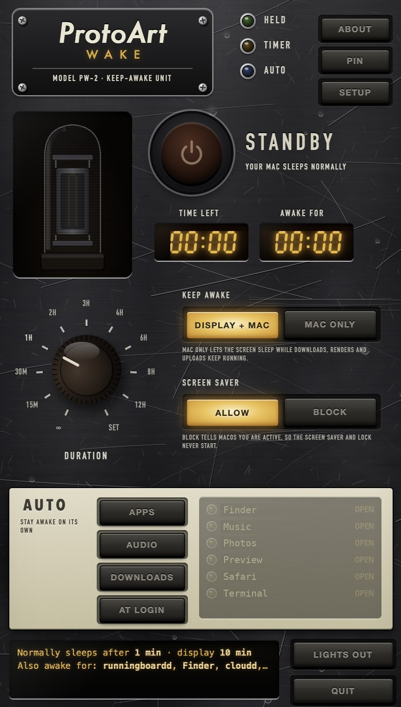
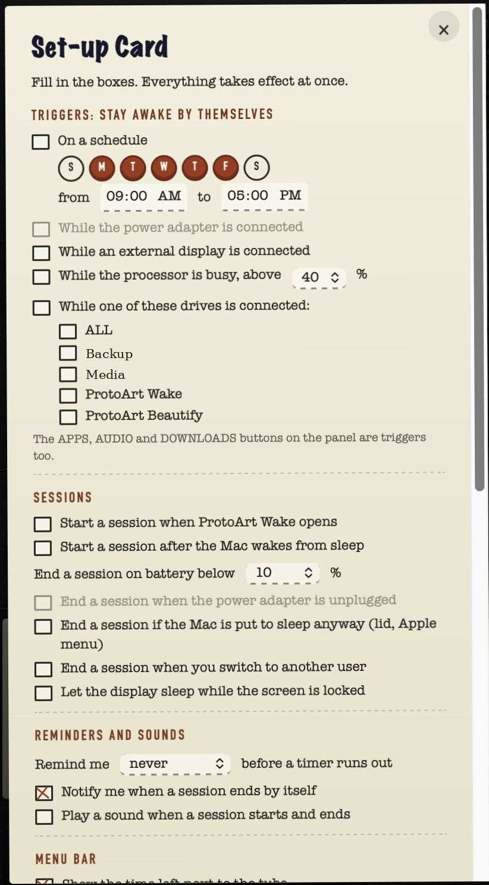
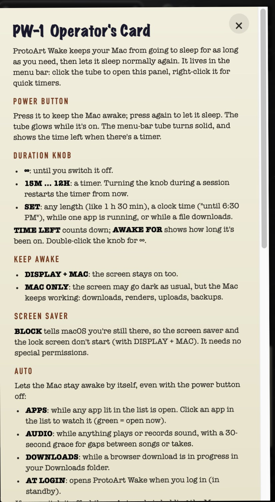

# ProtoArt Wake

**Keeps your Mac awake from the menu bar, in a tube-amp panel.**

ProtoArt Wake is a free, open-source menu-bar app for macOS. Click the tube in the menu bar, press the
power button, and your Mac stays awake until you switch it off or the timer runs out. It uses macOS's
own power assertions (the same ones `caffeinate` takes), confirms with macOS that the hold is really in
place, and can never leave your Mac stuck awake: the hold is tied to the app's process, so it ends if
the app quits or crashes.

Nothing is uploaded and the app makes no network connections.

## Screenshots

<p align="center">
  
  
  
</p>

The panel opens from the tube in the menu bar. **SETUP** opens the Set-up Card; **ABOUT** opens the Operator's Card.

## Download

Get the DMG from [Releases](https://github.com/theprotoart/protoart-wake/releases) or
[Hugging Face](https://huggingface.co/brushpenbob/protoart-wake). It isn't notarised yet: the first
time, open it from **System Settings → Privacy & Security → Open Anyway**.

## Features

- **Power button** with a warm-up tube, and a **duration knob**: ∞, 15 min, 30 min, 1–12 h, and **SET** for
  any length, a clock time ("until 6:30 PM"), while one app is running, or while a file downloads.
  The menu-bar tube shows the time left.
- **Right-click menu** like Amphetamine's: End and **Extend Session**, Indefinitely, Minutes, Hours, Other Time /
  Until, While App Is Running, While File Is Downloading, Quick Settings, Triggers.
- **KEEP AWAKE:** DISPLAY + MAC, or MAC ONLY (the screen may sleep; downloads and renders keep running).
- **SCREEN SAVER:** ALLOW or BLOCK (tells macOS you're active so the screen saver and lock don't start).
- **AUTO / triggers:** stay awake while chosen apps are open, while audio plays or records, while a browser
  download is in progress, on a **schedule**, while the **power adapter** is connected, while an **external
  display** is connected, while a chosen **drive** is connected, or while the **processor is busy**.
- **Session rules:** start at launch or after waking; end below a battery level, when unplugged, when the Mac
  is put to sleep anyway, or when you switch user; let the display sleep while the screen is locked.
- **Reminders** before a timer ends, with Extend buttons in the notification; optional sounds.
- **Menu bar:** time left on or off, `1h 05m` or `1:05`, dim in standby, left-click opens the panel or
  toggles a session.
- **Drive Alive:** keeps chosen external drives from spinning down during a session.
- **Statistics:** sessions, total and longest time awake.
- **Hotkey** ⌃⌥⌘W, and **links** for Shortcuts and scripts: `protoart-wake://start?minutes=90`,
  `…/start?until=18:30`, `…/extend?minutes=30`, `…/end`, `…/toggle`, `…/panel`, `…/lights-out`.
- **HELD lamp:** lights only when macOS confirms the hold. **Status window:** your normal sleep settings and
  which other apps are keeping the Mac awake. **LIGHTS OUT:** turn the display off now.

## Light on your Mac

Version 2 is a native Mac app (Swift and AppKit, about 1 MB). It runs no helper programs and polls
nothing: macOS tells it when apps open and quit, the power source or displays change, drives mount,
the screen locks or any app takes a power assertion, and one timer is set only for the next moment
something can change. The panel is drawn by the Mac's built-in web view only while it is open and is
released 20 seconds after it closes. In standby it uses no processor time and roughly 20–30 MB of memory.

## Requirements

macOS 12 or newer, Apple Silicon or Intel.

## Build from source

Needs Apple's Command Line Tools (`xcode-select --install`).

```bash
bash "Build ProtoArt Wake.command"          # or double-click it; runs the built-in self-test
bash "Make DMG for friends.command"         # or double-click it
```

The Swift source is in `native/`; the panel (HTML/CSS/JS) is in `app/renderer/`. The rest of `app/` is
the version 1 (Electron) code, kept for reference and its tests (`npm test`).

## How it works

| Control | macOS mechanism |
|---|---|
| DISPLAY + MAC | `IOPMAssertionCreateWithName`: PreventUserIdleDisplaySleep + PreventUserIdleSystemSleep |
| MAC ONLY | PreventUserIdleSystemSleep |
| SCREEN SAVER: BLOCK | `IOPMAssertionDeclareUserActivity` every 30 s |
| HELD lamp / others | `IOPMCopyAssertionsByProcess`, woken by the assertions-changed notification |
| AUTO: APPS | `NSWorkspace` launch and quit notifications |
| AUTO: AUDIO | the audio daemon's own assertion (present while any device plays or records), 30 s grace |
| AUTO: DOWNLOADS | a folder watch on ~/Downloads; names and dates of partial downloads only |
| Power, battery | `IOPSNotificationCreateRunLoopSource` |
| Displays, drives, lock, sleep, user switch | AppKit and workspace notifications |
| Processor busy | the kernel's CPU tick counters, every 10 s only while that trigger is on |
| Hotkey | Carbon `RegisterEventHotKey` (no Accessibility permission) |
| Open at login | `SMAppService` |
| LIGHTS OUT | `pmset displaysleepnow` |

Closing a laptop lid still sleeps it unless an external display is connected (macOS's clamshell rule);
ProtoArt Wake doesn't install a privileged helper to override that.

## License

Apache-2.0. See LICENSE, NOTICE and THIRD_PARTY_NOTICES.md.
